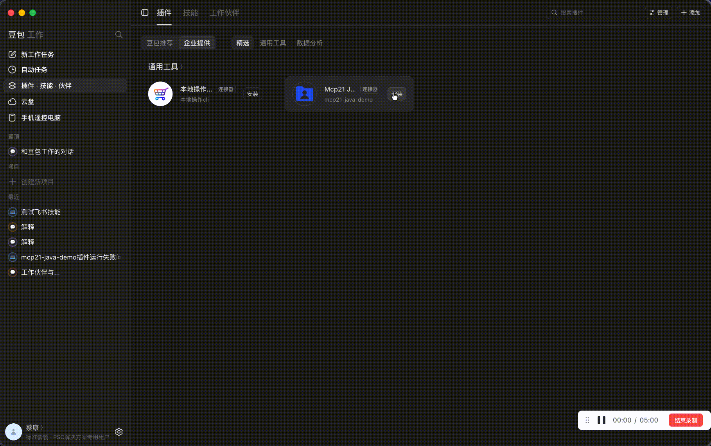
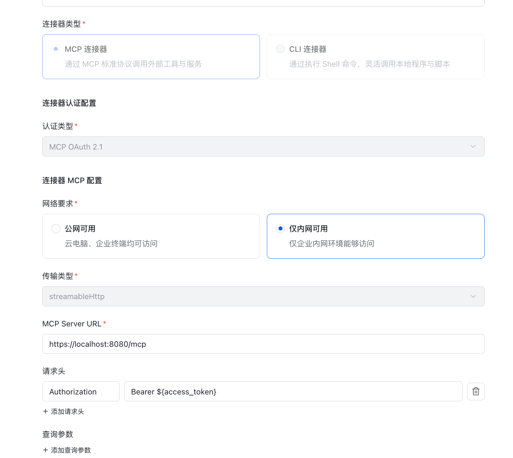
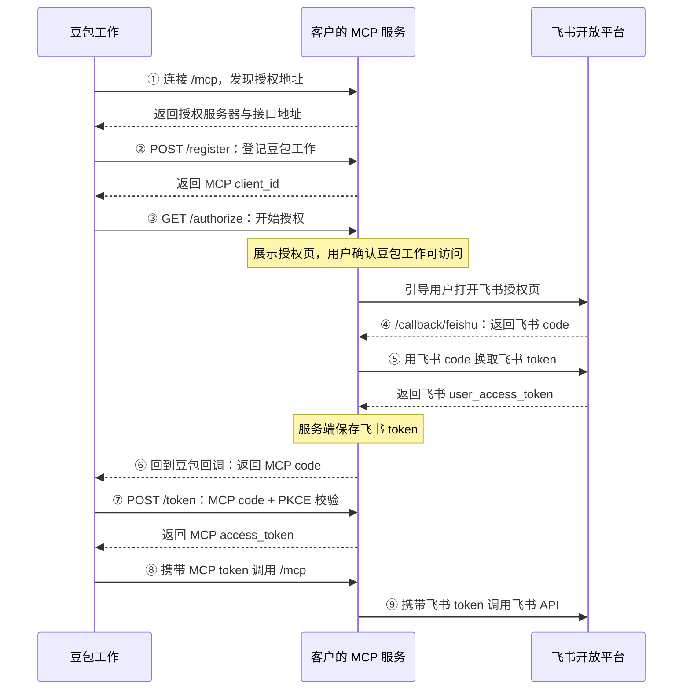

[豆包工作MCP OAuth 2.1：快速指南与标准接口清单](https://bytedance.larkoffice.com/wiki/J67uwaisKilV8MkkWmAcfOPKnDd?from=wiki)

# Java MCP OAuth 2.1 Demo

通过飞书登录授权，将 MCP 服务接入豆包工作。示例工具 `whoami` 返回当前授权用户的姓名和 `open_id`。

基于 Spring Boot 和 MCP Java SDK，支持动态客户端注册、授权码流程、S256 PKCE、MCP 令牌签发与刷新，以及 Streamable HTTP。**Java 17 / 21 均已验证，无需数据库。**



## 项目定位与核心价值

- **协议接入示例**：演示 MCP 资源与授权服务器发现、动态客户端注册、S256 PKCE 授权码、MCP Token 轮换与 Streamable HTTP 通信；具体实现及限制见下文。
- **双层 Token 隔离与身份穿透**：豆包工作客户端仅持有本服务签发的 MCP Token，飞书凭据保留在服务端，在工具调用时通过 `grant_id` 查找当前用户凭据。业务系统授权和企业审计仍需按实际需求实现。
- **开箱即用与跨平台**：内置飞书 Mock 模拟器与本地开发 CA 证书生成脚本，支持 macOS、Windows (Git Bash) 与 Linux 快速启动。

## 快速接入豆包工作

### 1. 准备飞书应用

1. 在飞书开放平台创建企业自建应用，获取 App ID 和 App Secret。
2. 在应用“安全设置”中添加重定向 URL：`https://localhost:8080/callback/feishu`。
3. 按业务需要开通用户权限并发布应用。配置模板使用 `contact:user.employee_id:readonly offline_access`。

### 2. 配置并启动 HTTPS 服务

先安装 **JDK 17 或 21**（包含 `java` 和 `javac`）及 OpenSSL。Windows 使用 **Git for Windows 的 Git Bash** 执行本文 Bash 命令；PowerShell / CMD 不能直接照抄 `source`、`export` 等命令。安装完成后重新打开 Git Bash，并检查：

```bash
java -version
javac -version
openssl version
```

如果 Java 不在 PATH 中，或自动检测选中了其他版本，在当前终端指定实际 JDK 安装目录，例如：

```bash
# 将路径替换成自己电脑上的 JDK 17 或 21 目录，保留引号。
export JAVA_HOME='/c/Program Files/Eclipse Adoptium/jdk-21.0.x-hotspot'
export PATH="$JAVA_HOME/bin:$PATH"
```

在项目根目录执行：

```bash
cp .env.local.example .env.local
chmod 600 .env.local
chmod +x mvnw run-local.sh scripts/generate-local-cert.sh
```

编辑 `.env.local`，填写自己的 `FEISHU_APP_ID`、`FEISHU_APP_SECRET` 和 `FEISHU_SCOPES`。本地 HTTPS 配置已在模板中提供：

```dotenv
PUBLIC_BASE_URL=https://localhost:8080
PORT=8080
SSL_ENABLED=true
SSL_CERTIFICATE=file:./.certs/localhost.crt
SSL_CERTIFICATE_PRIVATE_KEY=file:./.certs/localhost.key
FEISHU_MOCK=false
```

生成本地 HTTPS 证书：

```bash
./scripts/generate-local-cert.sh
```

**导入并信任本地根证书（关键步骤）：**

- **macOS**：在“钥匙串访问”中导入 `.certs/local-ca.crt`，设为 SSL“始终信任”。
- **Windows**：双击 `.certs/local-ca.crt` -> 点击“安装证书” -> 选择“当前用户” -> 选择“将所有的证书都放入下列存储” -> 浏览选择**“受信任的根证书颁发机构”** -> 确认并完成导入。

启动服务：

```bash
./run-local.sh
```

`run-local.sh` 按 `JAVA_17_HOME`、`JAVA_HOME` 的顺序读取显式配置；未设置时，macOS 先查询系统 JDK 和 Homebrew JDK，再从 PATH 中 Java 返回的 `java.home` 查找真实目录。其他平台从 PATH 检测；均校验 JDK 17/21 及 `javac`。配置错误时会报错，请修正变量后重试。也可在已设置 JDK 17/21 的 Bash / Zsh / Git Bash 中直接执行：

```bash
set -a
source .env.local
set +a
./mvnw spring-boot:run
```

脚本和 `.env.local` 须保存为 LF 换行。仓库通过 `.gitattributes` 固定 Bash 脚本及环境配置模板的换行符；Windows 上 `chmod` 不能代替 NTFS 文件权限设置。

首次运行会通过 Maven Wrapper 下载构建依赖。`.env.local` 和 `.certs/` 已被 Git 忽略，App Secret 仅保存在服务端。

`FEISHU_SCOPES` 以空格分隔；设为 `''` 时，飞书授权请求不携带 `scope` 参数，这不代表一定跳过用户授权确认。

### 3. 后台配置连接器并上传技能

管理员在豆包工作管理后台配置 MCP 连接器：

| 配置项 | 本地 Demo 配置 |
| --- | --- |
| 唯一标识 | `mcp21-java-demo` |
| 连接器类型 | MCP 连接器 |
| 认证类型 | MCP OAuth 2.1 |
| 网络要求 | 仅内网可用 |
| 传输类型 | `streamableHttp` |
| MCP Server URL | `https://localhost:8080/mcp` |
| 请求头 | `Authorization: Bearer ${access_token}` |
| 查询参数 | 留空 |



本地联调需由运行服务的电脑访问 `localhost`，且证书受信任。“仅内网可用”仍需使用 HTTPS；云端执行时应配置云端可达的 HTTPS 地址。更换部署地址时，同步更新 `PUBLIC_BASE_URL`、证书和飞书后台的重定向 URL。

**管理员在豆包工作管理后台上传技能，并在插件中关联该技能。** 技能源码位于 [`skills/feishu-whoami-mcp/`](skills/feishu-whoami-mcp/)，可在项目根目录打包：

```bash
mkdir -p dist
(cd skills && zip -r ../dist/feishu-whoami-mcp.zip feishu-whoami-mcp -x '*/.DS_Store')
```

`dist/` 为本地打包产物，不提交到仓库。

### 4. 完成授权并验证

1. 在豆包工作安装管理员配置的插件，点击“连接”，确认授权并登录飞书。
2. 在对话中询问“我是谁”，确认返回当前飞书账号的 `name` 和 `open_id`。

直接在浏览器打开 `/mcp` 返回 `401` 属于正常鉴权行为。

## 本地模拟与测试

不接入真实飞书时，在未加载 `.env.local` 的新终端执行：

```bash
./mvnw spring-boot:run
```

默认启用飞书模拟器，服务地址为 `http://localhost:8080`，无需 App ID 或 App Secret。此模式用于本地开发；接入豆包工作按上文配置 HTTPS。

运行测试：

```bash
./mvnw test
bash tests/test-local-scripts.sh
```

Java 测试覆盖动态注册、模拟飞书回调、PKCE、授权码防重放、MCP 令牌刷新及飞书错误信息脱敏。脚本测试在临时目录运行，覆盖 JDK 定位、带空格路径、无效配置、证书链与 SAN、CA 复用及直接执行权限；不读取真实 `.env.local`，不导入系统信任证书。CI 在 Windows Git Bash、macOS、Linux 上分别使用 JDK 17/21 运行这些检查。

## 架构演进与生产落地指南

本仓库为单进程内存存储示例。若需在企业生产环境中落地或接入业务系统，建议按以下方向演进：

1. **状态持久化与集群部署**：
   - 将 `InMemoryOAuthStore` 替换为 **Redis** 或关系型数据库（MySQL / PostgreSQL），持久化保存客户端注册信息（`oauth_clients`）、授权流（`login_flows`）及 Token 映射（`feishu_grants`、`mcp_tokens`），避免服务发版或重启导致客户端连接失效。
2. **凭证自动续期**：
   - 补充飞书 `refresh_token` 的自动刷新逻辑，当飞书 `user_access_token` 即将过期时后台自动静默续期，并处理刷新凭据过期、授权撤销与刷新失败；这些情况下仍需用户重新授权。
3. **接入企业已有业务系统 API**：
   - **单账号/系统级权限**：在 `McpConfiguration` 中注册业务 Tool（如查询 ERP 订单、工单流转），在 Tool 实现中直接调用业务系统后端 API。
   - **用户级权限穿透**：改造 `/authorize` 流程对接企业统一 SSO，扩展当前 `FeishuGrant` 数据模型以保存用户的业务系统身份/凭据，MCP 工具执行时从 `McpAuthContext` 提取当前用户凭据，结合业务系统的鉴权实现数据权限与操作审计；传递用户身份本身不会自动实现 RBAC。

## 授权流程与接口



**MCP token → grant_id → 飞书凭证。** MCP `client_id` / `client_secret` 与飞书 App ID / App Secret 是两套独立凭证，飞书 token 始终保留在服务端。

| 接口 | 用途 |
| --- | --- |
| `GET /.well-known/oauth-protected-resource/mcp` | MCP 资源与授权服务器发现 |
| `GET /.well-known/oauth-authorization-server` | OAuth 端点和支持能力 |
| `POST /register` | 动态客户端注册 |
| `GET /authorize`、`POST /authorize` | 校验授权请求、展示确认页并跳转飞书 |
| `GET /callback/feishu` | 兑换飞书凭证，返回 MCP 授权码 |
| `POST /token` | 兑换 MCP token 或轮换 MCP refresh token |
| `/mcp` | 受保护的 Streamable HTTP 服务 |

手动发送 MCP POST 请求时，携带以下请求头：

```http
Authorization: Bearer <MCP access token>
Accept: application/json, text/event-stream
Content-Type: application/json
```

未授权响应通过 `WWW-Authenticate` 中的 `resource_metadata` 指向资源发现接口。可检查 HTTPS 发现端点：

```bash
curl --cacert .certs/local-ca.crt https://localhost:8080/.well-known/oauth-protected-resource/mcp
curl --cacert .certs/local-ca.crt https://localhost:8080/.well-known/oauth-authorization-server
```

## 常见问题与排查

| 现象 | 检查项 |
| --- | --- |
| 安装失败，服务没有请求日志 / 无法建立安全连接 | 1. 服务是否启动、端口是否可达；<br>2. 证书是否受信任（Windows 必须导入到“受信任的根证书颁发机构”，macOS 设为“始终信任”）；<br>3. `localhost` 是否指向运行服务的电脑 |
| `INVALID_AUTHORIZATION_URL` | 授权端点是否使用 HTTPS |
| 飞书回调地址错误 | 登记的 URL 与实际 `redirect_uri` 的协议、主机、端口、路径是否完全一致 |
| `Missing state or browser cookie` | 从豆包重新发起授权，保持同一浏览器及主机名，不要直接打开回调地址 |
| Windows Git Bash 报 `$'\r': command not found` 或 `bash\r` | 检查脚本和 `.env.local` 是否为 CRLF。用编辑器转换为 LF，或在已安装 dos2unix 时执行 `dos2unix mvnw run-local.sh scripts/generate-local-cert.sh .env.local`。仅改 `core.autocrlf` 再 `git pull` 不保证重写已有文件 |
| IDEA 点击启动报错 | 1. IDEA 默认不读取 `.env.local`，需在 Run Configurations 手动配置环境变量；<br>2. 确保 Working directory 为项目根目录；<br>3. 确保 Project SDK 为 Java 17/21 |
| 重启后出现 `invalid_client` 或 `/mcp` 返回 `401` | 内存中的注册和令牌已清空，需重新注册并授权；生产环境请按上文指引接入持久化存储 |
| `/token` 返回 `invalid_grant` | 授权码是否过期或重复使用，PKCE、客户端、resource、回调地址是否匹配；刷新时是否使用最新令牌 |

Demo 采用单进程内存存储，重启会清空客户端注册、授权流程和令牌。已实现 **MCP refresh token 轮换**，尚未实现**飞书 token 刷新**；两类 MCP token 的有效期均不超过飞书 access token，到期后需重新授权。客户端沿用旧注册时，卸载后重新安装连接器。

生产部署还需统一密钥管理、事务及多实例并发控制，并使用受信任的 HTTPS 证书。
